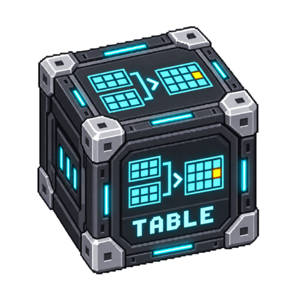

# Table Tools

Normalize JSON or CSV rows, project columns, compare two tables and join records
using explicit unique keys. Computations are deterministic; no LLM is involved.

<!-- block-metadata:start -->
[](model.json)
[](compatibility.json)
[](LICENSE)

Verified BloxSmith versions: **1.0.9** (bundled-block tests; see [test evidence](compatibility.json)).
<!-- block-metadata:end -->

[](media/cover.png)

## Ports

| Direction | Port | Value |
| --- | --- | --- |
| Input | `tables` | Required JSON row array, `{"rows":[...]}`, or CSV file path / `{"path":"file.csv"}` |
| Input | `reference` | Optional reference table in the same format; required by compare and join operations |
| Output | `rows` | Normalized/projected/joined rows as JSON |
| Output | `differences` | JSON object containing `added`, `removed` and `changed` arrays |
| Output | `summary` | Operation, row/change counts and bounded rejected-row diagnostics |

`tables` triggers execution. `reference` is optional for runtime scheduling and its
latest available value is used; provide it before triggering a comparison, or use
a GET source. The block refuses comparison/join when no reference is available.
An empty array is a valid table. Inputs are never modified or overwritten.

## Settings

- `operation`: `normalize`, `select`, `compare`, `inner_join`, or `left_join`.
- `keys`: distinct column names, required for compare/joins. Both tables must have
  unique, non-null scalar keys; ambiguous duplicates fail instead of multiplying rows.
- `columns`: optional output projection; required by `select`. Selected columns must
  exist in the primary table. Key columns remain available internally until processing ends.
- `column_types`: mappings to `string`, `integer`, `number`, `boolean`, or `json`.
  Null stays null; a missing configured column is invalid. Boolean conversion only
  accepts booleans and the strings `true`/`false`, case-insensitively. Numbers must
  be finite; booleans never become numbers. Integer conversion does not truncate fractions.
- `allowed_root`: CSV read boundary. Empty uses the application directory. Relative
  roots resolve from that directory; relative file inputs resolve from this boundary.
  Resolved paths, including symlinks, must remain within it. This is not an OS sandbox.
- `delimiter`, `encoding`: CSV separator and one of `utf-8-sig`, `utf-8`, `latin-1`.
- `max_rows`: 1–100,000 per table, default 10,000.
- `max_bytes`: 1,024–4,194,304 per input, default 2 MiB; decoded CSV is checked too.
- `reject_invalid_rows`: false by default. True omits malformed/failed-conversion
  rows and reports their positions, up to 1,000 issues per input. File structure,
  duplicate-key and size errors still fail the whole activation.

Each row has at most 256 columns. Final combined output is limited to 8 MiB. There
is no XLSX support, CSV export or implicit formula execution in this initial block.
Use a dedicated, formula-safe exporter when sending rows to spreadsheet software.

## Example

Set `operation=compare`, `keys=["id"]`, `column_types={"quantity":"integer"}`.
Send the reference first:

```json
[{"id":"A","quantity":2}]
```

Then send `tables`:

```json
[{"id":"A","quantity":"3"},{"id":"B","quantity":"1"}]
```

`differences` contains B in `added` and A in `changed`, with complete `before` and
`after` rows. Removed records come from the reference. For joins, shared keys are
kept once; other conflicting reference column names receive `reference.`. A remaining
name collision fails explicitly. An unmatched left-join row contains only its original fields.

## Execution and UI

One activation processes one bounded batch in both One Shot and Active Runtime.
It has no external side effects or persistent state. A cancellation, missing reference,
invalid setting or ambiguous input publishes no partial output. Errors do not log
entire rows. Both forms validate settings before Apply; drafts remain local until
Apply and survive runtime refresh. Close/Cancel discards drafts. Restart a loaded
Run after changing settings.

The modal groups primary settings above a collapsible advanced section. The
inspector offers the same controls, the shared directory picker and a Ports tab.
The package owns English/French catalogs, release-scoped styles and ES modules.

## Development

Tests live in `tests/` and use the private workspace's disposable framework harness.
They never target a real project or modify source files. Compatibility is recorded
only after successful execution against a pinned framework commit. No commit,
push, tag or release is implied by the initial development version.
